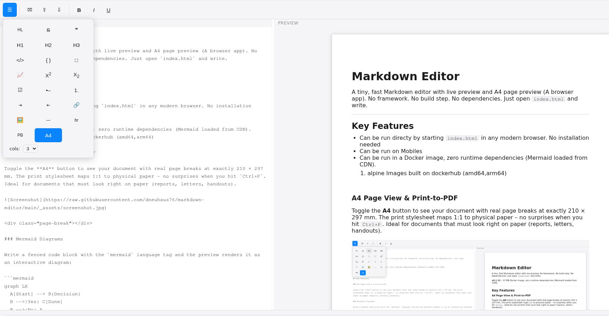
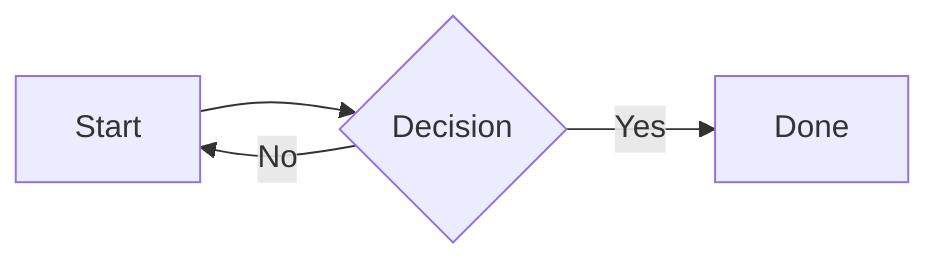

# Markdown Editor

A tiny, fast Markdown editor with live preview and A4 page preview (A browser app). No framework. No build step. No dependencies. Just open `index.html` and write.

---

## Key Features

* Can be run directy by starting `index.html` in any modern browser. No installation needed
* Can be run on Mobiles
- Can be run in a Docker image, zero runtime dependencies (Mermaid loaded from CDN).
  - alpine Images built on dockerhub (amd64,arm64)
<br>
### A4 Page View & Print-to-PDF

Toggle the **A4** button to see your document with real page breaks at exactly 210 × 297 mm. The print stylesheet maps 1:1 to physical paper – no surprises when you hit `Ctrl+P`. Ideal for documents that must look right on paper (reports, letters, handouts).



<div class="page-break"></div>

### Mermaid Diagrams

Write a fenced code block with the `mermaid` language tag and the preview renders it as an interactive diagram:



Flowcharts, sequence diagrams, Gantt charts – all supported. The toolbar button inserts a ready-to-edit template.

### Split View with Live Preview

Editor on the left, rendered output on the right. Updates in real time as you type. On mobile: swipe between editor and preview, or use the toggle labels.

### Image Embedding

==Drag & drop an image into the editor== – it becomes a base64 Data-URI in your document. Paste from clipboard works too. The file is self-contained; no external image references to break.

---

### Task Lists with Clickable Checkboxes

```markdown
- [x] Write README
- [ ] Ship v1.0
```

Checkboxes are interactive in the preview – click to toggle, and the editor updates.

### Find & Replace

`Ctrl+F` / `Ctrl+H` with a dedicated search bar. Works across the full document, not just the visible viewport.


<div class="page-break"></div>
### Autosave & File System Access

- Autosaves to `localStorage` on every change.
- Import/export `.md` files.
- On Chromium: the File System Access API saves directly back to the open file (no "Save As" dialog).

### Dark Mode

Follows `prefers-color-scheme`. No toggle needed – it just works.

---

## Other Capabilities

| Feature | Detail |
|---|---|
| Toolbar | Burger menu with core actions + expandable panel; identical on desktop and mobile |
| Parser | Accepts both syntax variants: `*em*`/`_em_`, `**strong**`/`__strong__`, list markers `-`/`*`/`+` |
| Keyboard shortcuts | Bold, Italic, Link, Find, Replace, Undo, Print – all standard bindings |
| Heading IDs | `### Title {#id}` for anchor links |
| Highlight & sub/superscript | `==text==`, `H~2~O`, `x^2^` |
| Word/character counter | Status bar, always visible |
| Security | `sanitizeUrl()` blocks unsafe URL schemes (`javascript:`, `data:` in ``) |
| Responsive | Touch targets ≥ 40 px, mobile-first CSS |

---

## Start

### no Docker

Simply open `index.html` in any modern browser.

Or

```bash
cd markdown-editor
python3 -m http.server 8080
# → http://localhost:8080
```

### Docker (Images on dockerhub)

Simply download from dockerhub und start:
`docker run -d -p 8080:80 --name markdown-editor dneuhaus76/markdown-editor`

Or (build your own)

```bash
docker build -t markdown-editor:0.x .
docker run -d --name markdown-editor --restart unless-stopped -p 8080:80 markdown-editor:0.x
# → http://localhost:8080 (gzip, cache headers, health check)
```

---

## Structure

```
index.html       Layout + toolbar
css/style.css    Styles, responsive, dark mode, A4 print, status bar
js/markdown.js   Mini Markdown parser (testable via node)
js/app.js        State, toolbar, autosave, import/export, images, search, Mermaid
tests/           Parser unit tests (not needed by application)
Dockerfile       nginx on Alpine (not needed by application)
docker-compose.yml (not needed by application)
```

---

## Platform Strategy

- **Linux / Desktop**: browser (today)
- **Windows**: PWA or Tauri wrapper around the same base
- **Mobile**: PWA (responsive, touch-optimized)

---

## License

[GPL-3.0](LICENSE) (copyleft) – derivatives must stay open source.

Copyright (C) 2026 Daniel Neuhaus
